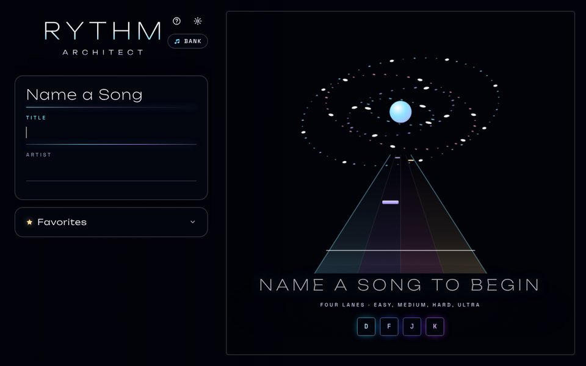
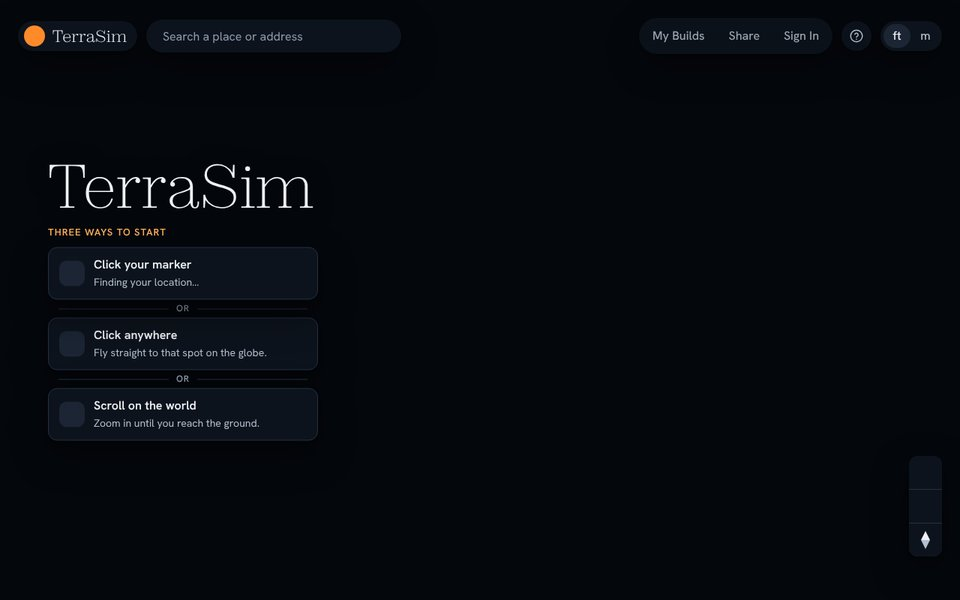
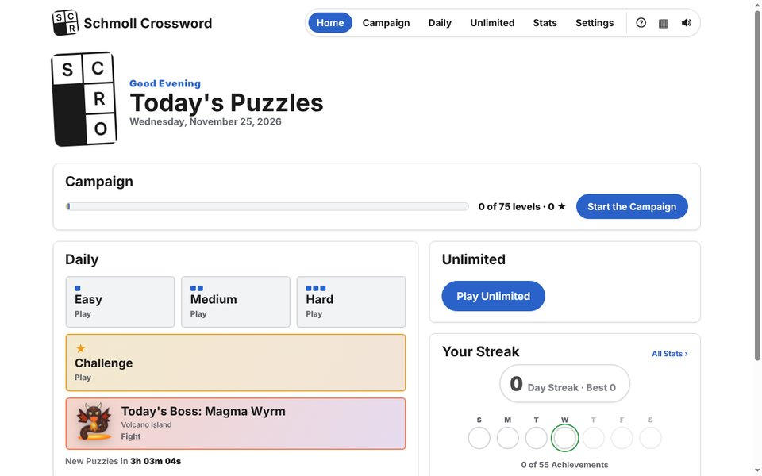
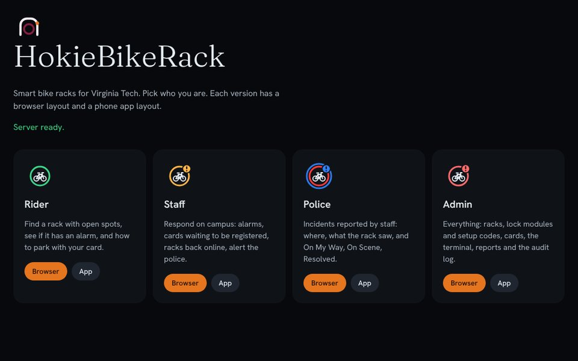

<h1 align="center">Hi, I'm Miles 👋</h1>

  <b>Computer Science @ Virginia Tech</b> · I learn new technologies by building with them

  
  
  

---

### About me

- 🎓 B.S. in Computer Science at **Virginia Tech**, Class of 2029
- 🏆 **2nd Place & Best Use of Gemma** at a Google Developer Group Hackathon, as lead developer of [TerraSim](https://terrasim.house)
- 🛠️ I build full-stack web apps, games, embedded hardware, and AI-powered tools
- 🔭 Right now: building **Rhythm Architect** and a big update to **Schmoll Crossword**

---

### Featured projects

<table>
  <tr>
    <td width="50%" valign="top">
      
      <h3><a href="https://rhythmarchitect-frontend.onrender.com">Rhythm Architect</a></h3>
      
A browser rhythm game that turns any song into a playable 4-lane beatmap, using onset detection and an ML charting model running in the browser.

      
<b>TypeScript · React · Three.js · Java · Spring Boot</b>

      
<a href="https://rhythmarchitect-frontend.onrender.com">Play it</a> · <a href="https://github.com/milesjdantonio/RhythmArchitect">Code</a>

    </td>
    <td width="50%" valign="top">
      
      <h3><a href="https://terrasim.house">TerraSim</a> 🏆</h3>
      
Outline a lot on a 3D map and get an AI-generated floor plan, a furnished 3D walkthrough, and a cost estimate. <b>2nd Place & Best Use of Gemma.</b>

      
<b>JavaScript · Three.js · MapLibre · Go · PostgreSQL · Gemma</b>

      
<a href="https://terrasim.house">Try it</a> · <a href="https://github.com/milesjdantonio/TerraSim">Code</a>

    </td>
  </tr>
  <tr>
    <td width="50%" valign="top">
      
      <h3><a href="https://schmollcrossword.com">Schmoll Crossword</a></h3>
      
A free crossword game with daily puzzles, unlimited puzzles, and a 15-world campaign. Grids come from a backtracking generator; clues are written and reviewed with the Claude API.

      
<b>Java · Spring Boot · JavaScript · Claude API · Docker</b>

      
<a href="https://schmollcrossword.com">Play it</a>

    </td>
    <td width="50%" valign="top">
      
      <h3><a href="https://hokiebikerack.onrender.com">HokieBikeRack</a></h3>
      
A smart bike rack prototype: NFC cards unlock it, an accelerometer sets off a tamper alarm, and a live dashboard lets staff, police, and admins respond.

      
<b>C++ (Arduino) · Java · Spring Boot · PostgreSQL</b>

      
<a href="https://hokiebikerack.onrender.com">See it</a> · <a href="https://github.com/milesjdantonio/HokieBikeRack">Code</a>

    </td>
  </tr>
</table>

The Render-hosted sites sleep when idle, so the first load can take up to a minute.

---

### Tech I use

  

Also: Claude API · Gemini API · Gemma · REST APIs · JUnit · Vitest · Playwright

---

  <a href="https://www.linkedin.com/in/miles-dantonio">LinkedIn</a> · <a href="mailto:milesjdantonio@gmail.com">milesjdantonio@gmail.com</a>

